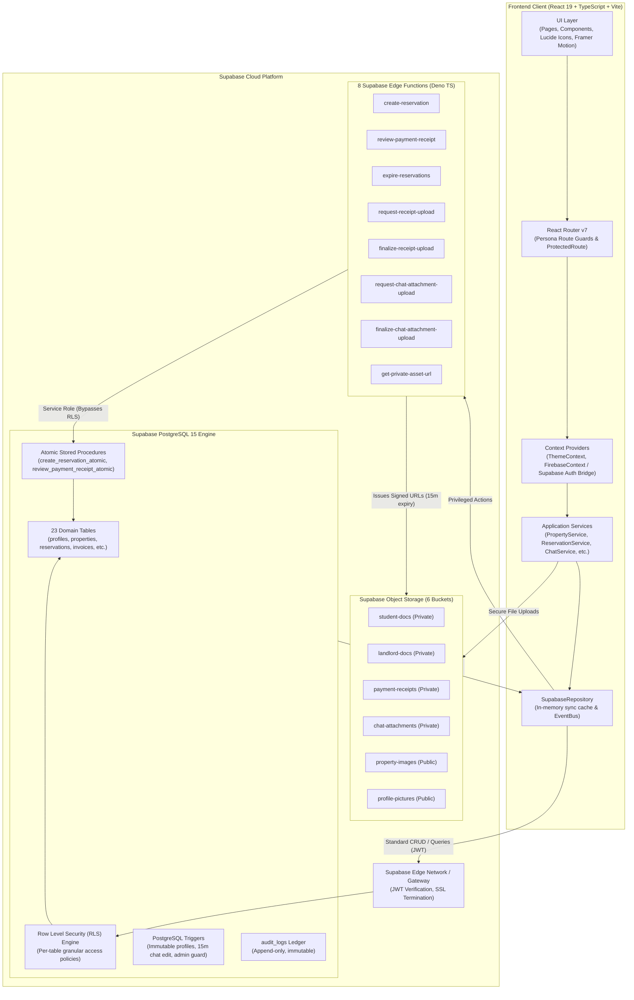

# OUTPOST System Architecture

> **Authoritative Technical Architecture Document for OUTPOST — Bayero University Kano Student Accommodation Platform.**

---

## 1. System Context & Overview

OUTPOST is a web-based student housing platform engineered specifically for the off-campus ecosystem of **Bayero University Kano (BUK) New Site**, located along Gwarzo Road in Kano State, Nigeria. The application directly addresses the accommodation discovery and coordination friction across two primary residential corridors:
1. **Dambare**: High-density off-campus student hub directly opposite the BUK New Campus main gate.
2. **Rimin Gata**: Quiet residential area west of the campus featuring gated student lodges.

The system serves three primary user personas:
- **Students**: Discover verified lodges, verify academic credentials, calculate roommate compatibility, form shared accommodation groups, reserve rooms with 7-day holds, generate invoices, and submit bank transfer receipts.
- **Landlords**: List student accommodations, manage room capacities, upload land ownership documentation, and review tenant payment receipts.
- **Administrators**: Review verification queues, vet landlords, inspect and approve listings, enforce platform policies, review system audit logs, and manage platform maintenance settings.

---

## 2. Architectural Style & Principles

OUTPOST adheres to a **Layered Clean Architecture** combined with a **Serverless Backend-as-a-Service (BaaS)** model centered on Supabase:

1. **Domain-Driven Isolation**:
   - The `domain/` layer contains pure entities, type definitions, and business algorithms (`matching.ts`, `geoUtils.ts`). It has zero runtime dependencies on React, Supabase, or external I/O.
2. **Application Service Facade**:
   - The `application/` layer provides cohesive services (`authService`, `propertyService`, `reservationService`, `verificationService`, `chatService`, `adminService`) orchestrating use cases.
3. **Repository Pattern with Optimistic Caching**:
   - The `infrastructure/` layer implements the `IRepository` interface via `SupabaseRepository`. It maintains an in-memory synchronized entity cache to provide synchronous, responsive UI updates while persisting state mutations to Supabase PostgreSQL and Edge Functions.
4. **Zero Client Trust & Defense-in-Depth**:
   - The React frontend is treated as completely untrusted. Financial transactions, inventory allocation, and privilege elevation occur inside PostgreSQL stored procedures or Supabase Edge Functions with strict Row Level Security (RLS).
5. **Privacy by Design**:
   - Landlord device GPS coordinates and private document uploads are shielded from public endpoints through coordinate jitter/rounding and short-lived signed URLs.

---

## 3. High-Level Architecture Diagram



---

## 4. Major Architectural Layers

### 4.1 Presentation Layer (`src/pages/`, `src/components/`)
- Built with React 19 and functional components with hooks.
- Styled using Tailwind CSS 4.1 with native CSS imports and dynamic theme switching (Dark/Light).
- Structured into 4 distinct persona spaces:
  - `pages/public/`: Landing page, search catalog, listing detail view, authentication.
  - `pages/student/`: Dashboard, verification, roommate preferences, requests, groups, reservations, invoices, chat.
  - `pages/landlord/`: Dashboard, listing creator, availability manager, receipt verification.
  - `pages/admin/`: Verification queue, property approvals, user directory, disputes, audit log ledger.
- Route protection is managed in `src/App.tsx` through `ProtectedRoute`, validating active sessions and required roles (`student` | `landlord` | `admin`).

### 4.2 Application Services Layer (`src/application/services/`)
Orchestrates high-level business use cases:
- **`authService.ts`**: Manages user login, session serialization, profile retrieval, and role mapping.
- **`propertyService.ts`**: Handles search filters, corridor scoping (Dambare/Rimin Gata), listing lifecycle (`draft` -> `pending` -> `approved`), and room capacity aggregation.
- **`reservationService.ts`**: Initiates 7-day holds, generates invoices, processes receipt submissions, and reviews payments.
- **`verificationService.ts`**: Coordinates student academic document uploads and landlord legal submissions.
- **`roommateService.ts`**: Manages roommate preferences, matching request dispatches, and accommodation group coordination.
- **`chatService.ts`**: Powers real-time peer-to-peer and group messaging with attachments and 15-minute message edit enforcement.
- **`adminService.ts`**: Manages administrative verification queues, listing approvals, user suspensions, and audit logs.

### 4.3 Domain Layer (`src/domain/`)
- Encapsulates domain logic independent of any library or database:
  - **`types.ts`**: Authoritative domain models, entity interfaces, and status ENUMs.
  - **`matching.ts`**: Explainable, deterministic 6-dimension roommate compatibility algorithm.
  - **`geoUtils.ts`**: Haversine distance calculations, geohash encoding, and privacy-preserving coordinate jitter.
  - **`locations.ts`**: Geographic corridor definitions for Dambare and Rimin Gata around BUK New Site.
  - **`repository.ts`**: Contract for data repository access.

### 4.4 Infrastructure Layer (`src/infrastructure/`)
- Adapts application services to external infrastructure:
  - **`supabase/supabaseClient.ts`**: Initializes `@supabase/supabase-js` client with session persistence and error handling.
  - **`supabase/supabaseRepository.ts`**: Implements `IRepository`, synchronizing 23 domain tables with local in-memory caching and real-time event broadcasting.
  - **`supabase/supabaseStorageService.ts`**: Coordinates uploads and signed URL downloads across 6 Supabase Storage buckets.
  - **`events/eventBus.ts`**: Decoupled in-browser PubSub bus for instant reactive UI updates.

---

## 5. Authentication & Authorization Boundaries

```
[User Browser]
      │
      ▼
1. Client-Side Guard (ProtectedRoute)
      • Inspects session and currentUser.role
      • Redirects unauthorized roles to /unauthorized or /login
      │
      ▼
2. Supabase API Gateway
      • Validates ES256 / HS256 JWT signature and expiry
      • Extracts authenticated uid and claims
      │
      ▼
3. PostgreSQL Row Level Security (RLS)
      • Enforces student, landlord, and admin isolation on every SQL query
      • e.g. "auth.uid() = student_id" OR "is_admin()"
      │
      ▼
4. Database Triggers & Stored Procedures
      • `protect_profile_immutable_fields`: Prevents non-admins from altering role or status
      • `enforce_message_edit_window`: Blocks message mutation after 15 minutes
      • `create_reservation_atomic`: Enforces row locks and capacity bounds
```

---

## 6. Data Flows & Key Workflows

### 6.1 Reservation & 7-Day Hold Allocation
1. Student selects a room unit in an approved listing and clicks "Hold Space".
2. Client invokes `reservationService.createReservation()`.
3. Application calls the Supabase Edge Function `create-reservation` or stored procedure `create_reservation_atomic`:
   - Enforces `account_status !== 'suspended'`.
   - Acquires an exclusive row lock (`SELECT ... FOR UPDATE`) on the target unit in `units`.
   - Validates that `available_spaces > 0`.
   - Decrements `available_spaces` by 1.
   - Inserts row in `reservations` with `status = 'pending_payment'` and `hold_expires_at = NOW() + INTERVAL '7 days'`.
   - Inserts row in `invoices` with `payment_status = 'pending'`.
   - Logs event in `audit_logs`.
4. Returns created reservation and invoice details to client.

### 6.2 External Payment & Landlord Receipt Review
1. Student makes an external bank transfer to the landlord's account shown on the invoice.
2. Student uploads the transfer receipt slip via `request-receipt-upload` into `payment-receipts` bucket.
3. Client triggers `finalize-receipt-upload`, creating a row in `payment_receipts` and moving reservation to `payment_submitted`.
4. Landlord navigates to `/landlord/receipts` and inspects the receipt via a 15-minute signed URL generated by `get-private-asset-url`.
5. Landlord submits decision:
   - **Approved**: `review_payment_receipt_atomic` marks reservation `confirmed`, invoice `paid`, and receipt `approved`.
   - **Rejected**: Requires mandatory `rejectionReason`. Releases unit capacity (`available_spaces = available_spaces + 1`) and returns reservation to `pending_payment`.

### 6.3 7-Day Hold Expiration Automation
1. A scheduled worker or admin trigger invokes `expire-reservations` Edge Function.
2. The function validates service-role bearer authentication and calls `expire_pending_reservations()` stored procedure:
   - Finds all reservations where `status = 'pending_payment'` and `hold_expires_at < NOW()`.
   - For each expired reservation, increments `units.available_spaces` by 1.
   - Updates reservation status to `expired` and invoice status to `cancelled`.
   - Records an entry in `audit_logs` for each expired reservation.

---

## 7. Storage Architecture & Privacy Design

OUTPOST separates media assets into 6 distinct buckets:

| Bucket Name | Public / Private | Allowed MIME Types | Max Size | Tenant Isolation Path |
| :--- | :--- | :--- | :--- | :--- |
| `student-docs` | Private | JPEG, PNG, PDF | 10 MB | `{studentId}/{docId}/{fileName}` |
| `landlord-docs` | Private | JPEG, PNG, PDF | 10 MB | `{landlordId}/{docId}/{fileName}` |
| `payment-receipts` | Private | JPEG, PNG, PDF | 10 MB | `{landlordId}/{studentId}/{reservationId}/{fileName}` |
| `chat-attachments` | Private | JPEG, PNG, PDF, WebP | 10 MB | `{conversationId}/{senderId}/{fileName}` |
| `property-images` | Public | JPEG, PNG, WebP | 10 MB | `{landlordId}/{propertyId}/{fileName}` |
| `profile-pictures` | Public | JPEG, PNG, WebP | 2 MB | `{userId}/{fileName}` |

### Signed URL Access Gate
Private assets cannot be accessed directly via public CDN URLs. Any request to view a student verification document, landlord title, chat attachment, or payment receipt must call the `get-private-asset-url` Edge Function. The function cryptographically verifies that the caller is:
1. The student owner,
2. The property landlord,
3. A participant in the conversation, or
4. A verified administrator.

Upon verification, it generates a short-lived Supabase Storage signed URL expiring in **900 seconds (15 minutes)**.

---

## 8. External Integrations & Boundaries

- **Supabase Authentication**: Handles user registration, email verification, password resets, and session tokens.
- **Supabase PostgreSQL 15**: Primary relational persistence engine with 23 tables, triggers, and RLS.
- **Supabase Storage**: Object storage for identity evidence, legal deeds, receipts, and listing media.
- **Supabase Edge Functions**: Serverless Deno runtime for privileged actions and scheduled jobs.
- **External Bank Transfer (Off-Platform)**: In line with MVP financial safety, payment occurs via direct Nigerian bank transfer (NIP/USSD) to landlord accounts. OUTPOST does not custody merchant funds or store card PANs.
- **Browser Geolocation API**: Optional, user-initiated device coordinate capture for nearest accommodation sorting. Coordinates are transient and never saved to student profile records.

---

## 9. Architectural Limitations & Trade-offs

1. **In-Memory Cache Synchronization**: `SupabaseRepository` provides fast local reads, but concurrent modifications in multi-tab sessions depend on Supabase Realtime event listeners.
2. **Asynchronous Cron Execution**: The automated expiration of 7-day holds relies on an external cron caller (e.g. `pg_cron` or scheduled webhook) invoking `expire-reservations`.
3. **Map-Free First Phase**: Focuses on corridor search (Dambare vs Rimin Gata) with coordinate obfuscation; full interactive Mapbox vector rendering is structured in `StudentHousingMapPage.tsx` for phase 2 release.
