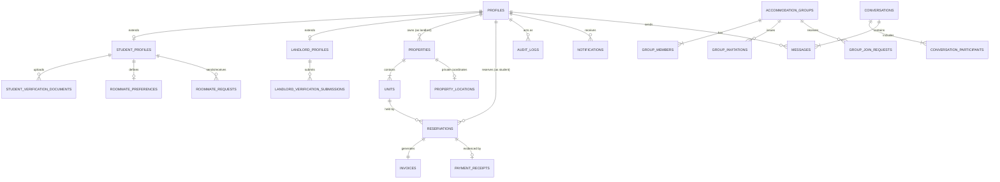

# OUTPOST Database & Schema Specification

> **Authoritative specification of the 23-table relational schema, Entity-Relationship (ER) model, constraints, triggers, stored procedures, Row Level Security (RLS) matrix, and storage bucket policies.**

## Authoritative Backend Statement

> **OUTPOST uses Supabase as its only active backend: Supabase Auth for authentication, Supabase PostgreSQL for persistence, PostgreSQL Row Level Security for authorization, Supabase Storage for files, Supabase Realtime for live communication, and Supabase Edge Functions and database procedures for privileged workflows. Firebase is legacy/archive material only and is not used by the active application.**

## Authoritative Database Migrations Statement

> **The authoritative database contract is the ordered set of timestamped SQL migrations in supabase/migrations/. Apply 20261020000001_initial_schema.sql, then 20261020000002_row_level_security.sql, then 20261020000003_storage_buckets_and_policies.sql, then 20261020000004_functions_triggers_and_automation.sql. Archived Firebase rules and functions are not the active backend contract.**

## Legacy Firebase Archive Note

> **The repository retains selected Firebase configuration, Firestore rules, Storage rules, and Cloud Function files for historical migration traceability and rollback analysis. These files are not part of the active OUTPOST runtime and must not be deployed or imported by the active frontend. Supabase is the only supported backend. The archive may be removed after production acceptance testing, backup verification, and explicit maintainer approval.**

---

## 1. Migration Hierarchy & Execution Sequence

All database schema definitions reside in `supabase/migrations/` and must be applied in strict alphabetical and timestamp order:

| Step | Migration File | Primary Responsibility |
| :---: | :--- | :--- |
| **1** | `20261020000001_initial_schema.sql` | Declares extensions, 11 custom ENUMs, domain tables, foreign keys, and CHECK constraints. |
| **2** | `20261020000002_row_level_security.sql` | Enables RLS on all domain tables and defines granular SELECT, INSERT, UPDATE, DELETE policies. |
| **3** | `20261020000003_storage_buckets_and_policies.sql` | Provisions 6 Supabase Storage buckets, MIME type whitelists, and storage RLS policies. |
| **4** | `20261020000004_functions_triggers_and_automation.sql` | Installs SECURITY DEFINER functions, atomic stored procedures, and immutable field triggers. |
| **5** | `20261020000005_pre_deployment_hardening.sql` | Applies FORCE RLS, auto-profile trigger `handle_new_user()`, capacity sync triggers, and cron helper. |
| **6** | `20261020000006_fix_landlord_registration_profile_initialization.sql` | Ensures landlord signup role assignment and profile initialization without client elevation. |
| **7** | `20261112000007_admin_live_metrics_and_rls_fixes.sql` | Hardens `is_admin()`, adds `admin_get_dashboard_metrics()`, landlord submission RPC, atomic admin governance RPCs, and email confirmation profile sync. |

---

## 2. Entity-Relationship (ER) Diagram

---

## 3. Comprehensive Domain Table Directory (23 Tables)

### 3.1 User & Identity Tables

#### `public.profiles`
- **Purpose**: Core user identity row linked 1:1 with Supabase `auth.users.id`.
- **Primary Key**: `id UUID REFERENCES auth.users(id) ON DELETE CASCADE`.
- **Columns**: `email TEXT`, `role user_role` (`student`, `landlord`, `admin`), `account_status account_status` (`active`, `email_unverified`, `profile_pending`, `profile_verified`, `rejected`, `suspended`), `full_name TEXT`, `phone TEXT`, `avatar_url TEXT`, `created_at TIMESTAMPTZ`, `updated_at TIMESTAMPTZ`.
- **Security Triggers**: `protect_profile_immutable_fields` prevents non-admins from mutating `role` or `account_status`.

#### `public.student_profiles`
- **Purpose**: Academic persona details for student tenants.
- **Primary Key**: `student_id UUID REFERENCES public.profiles(id) ON DELETE CASCADE`.
- **Columns**: `registration_number TEXT UNIQUE`, `institution_name TEXT` (Default: `'Bayero University Kano'`), `faculty TEXT`, `department TEXT`, `level TEXT` (`100`–`600`, `Postgraduate`), `gender TEXT`, `is_profile_verified BOOLEAN`, `created_at`, `updated_at`.
- **Constraints**: Unique registration number; trigger prevents self-setting `is_profile_verified = true`.

#### `public.student_verification_documents`
- **Purpose**: Academic proof uploaded by students for administrative vetting.
- **Primary Key**: `id UUID DEFAULT gen_random_uuid()`.
- **Columns**: `student_id UUID REFERENCES public.student_profiles(student_id)`, `document_type document_type` (`student_id`, `admission_letter`, `school_fees_receipt`), `storage_path TEXT`, `file_name TEXT`, `file_size INTEGER`, `status verification_status` (`pending`, `approved`, `rejected`), `reviewed_by UUID`, `reviewed_at TIMESTAMPTZ`, `rejection_reason TEXT`.
- **Constraints**: `file_size <= 10485760` (10 MB maximum).

#### `public.landlord_profiles`
- **Purpose**: Vetting records and business details for property managers.
- **Primary Key**: `landlord_id UUID REFERENCES public.profiles(id) ON DELETE CASCADE`.
- **Columns**: `legal_name TEXT`, `id_type TEXT` (`nin`, `drivers_license`, `voters_card`, `passport`), `id_number TEXT`, `verification_status verification_status`, `bank_name TEXT`, `account_number TEXT`, `account_name TEXT`, `created_at`, `updated_at`.
- **Security**: Bank details are displayed on student invoices for direct transfer.

#### `public.landlord_verification_submissions`
- **Purpose**: Land ownership deeds and identity credentials submitted by landlords.
- **Primary Key**: `id UUID DEFAULT gen_random_uuid()`.
- **Columns**: `landlord_id UUID REFERENCES public.landlord_profiles(landlord_id)`, `document_type TEXT` (`c_of_o`, `governor_consent`, `tax_clearance`, `deed_of_conveyance`), `storage_path TEXT`, `status verification_status`, `reviewer_notes TEXT`.

---

### 3.2 Property & Unit Tables

#### `public.properties`
- **Purpose**: Accommodation lodge listing records.
- **Primary Key**: `id UUID DEFAULT gen_random_uuid()`.
- **Columns**: `landlord_id UUID REFERENCES public.landlord_profiles(landlord_id)`, `title TEXT`, `description TEXT`, `area housing_area` (`Dambare`, `Rimin Gata`), `street_address TEXT`, `property_type property_type`, `gender_policy gender_policy`, `verification_status property_approval_status` (`draft`, `pending`, `approved`, `rejected`, `archived`), `public_latitude NUMERIC(9,6)`, `public_longitude NUMERIC(9,6)`, `images TEXT[]`, `amenities TEXT[]`, `created_at`, `updated_at`.
- **Visibility**: RLS policy restricts public and student visibility strictly to `verification_status = 'approved'`.

#### `public.units`
- **Purpose**: Specific room or space categories within an accommodation lodge.
- **Primary Key**: `id UUID DEFAULT gen_random_uuid()`.
- **Columns**: `property_id UUID REFERENCES public.properties(id) ON DELETE CASCADE`, `name TEXT`, `price_per_year NUMERIC(12,2)`, `capacity INTEGER CHECK (capacity > 0)`, `available_spaces INTEGER CHECK (available_spaces >= 0 AND available_spaces <= capacity)`, `is_available BOOLEAN`.
- **Engine-Level CHECK Constraint**: `available_spaces >= 0 AND available_spaces <= capacity` makes overbooking or negative inventory mathematically impossible.

#### `public.property_locations`
- **Purpose**: Private exact device GPS coordinates captured by landlords.
- **Primary Key**: `property_id UUID REFERENCES public.properties(id) ON DELETE CASCADE`.
- **Columns**: `exact_latitude NUMERIC(9,6)`, `exact_longitude NUMERIC(9,6)`, `geohash TEXT`, `precision location_precision`, `source location_source`.
- **Privacy Design**: RLS strictly blocks students from querying this table; only the owning landlord and administrators have read access.

---

### 3.3 Roommate & Group Tables

#### `public.roommate_preferences`
- **Purpose**: Compatibility questionnaire answers filled out by students.
- **Primary Key**: `student_id UUID REFERENCES public.student_profiles(student_id) ON DELETE CASCADE`.
- **Columns**: `min_budget NUMERIC(10,2)`, `max_budget NUMERIC(10,2)`, `preferred_neighbourhoods TEXT[]`, `move_in_period TEXT`, `cleanliness TEXT`, `study_habits TEXT`, `sleep_schedule TEXT`, `noise_tolerance TEXT`, `smoking TEXT`, `guest_preference TEXT`, `bio TEXT`.

#### `public.roommate_requests`
- **Purpose**: Direct connection requests between students.
- **Primary Key**: `id UUID DEFAULT gen_random_uuid()`.
- **Columns**: `sender_id UUID REFERENCES public.student_profiles(student_id)`, `receiver_id UUID REFERENCES public.student_profiles(student_id)`, `message TEXT`, `status request_status` (`pending`, `accepted`, `rejected`, `cancelled`).

#### `public.accommodation_groups`
- **Purpose**: Multi-student groups pooling funds for shared units.
- **Primary Key**: `id UUID DEFAULT gen_random_uuid()`.
- **Columns**: `leader_id UUID REFERENCES public.student_profiles(student_id)`, `name TEXT`, `target_area housing_area`, `max_members INTEGER CHECK (max_members >= 2 AND max_members <= 10)`, `status group_status`.

#### `public.group_members`
- **Primary Key**: `(group_id, student_id)`.
- **Columns**: `role TEXT` (`admin`, `member`), `joined_at TIMESTAMPTZ`.
- **Trigger**: `prevent_removing_last_group_admin` prevents orphan groups.

#### `public.group_invitations` & `public.group_join_requests`
- Manage group formation invitations and join approvals.

---

### 3.4 Reservation & Financial Tables

#### `public.reservations`
- **Purpose**: Authoritative 7-day room space holds.
- **Primary Key**: `id UUID DEFAULT gen_random_uuid()`.
- **Columns**: `student_id UUID REFERENCES public.profiles(id)`, `landlord_id UUID REFERENCES public.profiles(id)`, `property_id UUID REFERENCES public.properties(id)`, `unit_id UUID REFERENCES public.units(id)`, `group_id UUID REFERENCES public.accommodation_groups(id)`, `status reservation_status` (`pending_payment`, `payment_submitted`, `confirmed`, `cancelled`, `expired`), `hold_expires_at TIMESTAMPTZ NOT NULL`, `created_at`, `updated_at`.
- **Temporal Rule**: `hold_expires_at` is set to exactly `NOW() + INTERVAL '7 days'` upon creation.

#### `public.invoices`
- **Purpose**: Official academic accommodation fee invoice.
- **Primary Key**: `id UUID DEFAULT gen_random_uuid()`.
- **Columns**: `reservation_id UUID REFERENCES public.reservations(id) ON DELETE CASCADE`, `invoice_number TEXT UNIQUE`, `amount NUMERIC(12,2) CHECK (amount > 0)`, `payment_status invoice_payment_status` (`pending`, `submitted`, `paid`, `cancelled`), `landlord_bank_name TEXT`, `landlord_account_number TEXT`, `landlord_account_name TEXT`, `due_date TIMESTAMPTZ`.

#### `public.payment_receipts`
- **Purpose**: Bank transfer receipt evidence uploaded by students.
- **Primary Key**: `id UUID DEFAULT gen_random_uuid()`.
- **Columns**: `reservation_id UUID REFERENCES public.reservations(id) ON DELETE CASCADE`, `invoice_id UUID REFERENCES public.invoices(id)`, `student_id UUID REFERENCES public.profiles(id)`, `landlord_id UUID REFERENCES public.profiles(id)`, `storage_path TEXT`, `payment_reference TEXT`, `payer_bank_name TEXT`, `amount_paid NUMERIC(12,2)`, `status receipt_review_status` (`pending_review`, `approved`, `rejected`), `reviewed_by UUID`, `reviewed_at TIMESTAMPTZ`, `rejection_reason TEXT`, `file_size INTEGER CHECK (file_size <= 10485760)`.

---

### 3.5 Messaging, Notifications & Governance Tables

#### `public.conversations` & `public.conversation_participants`
- Track direct and group message threads. RLS ensures only participants can read messages.

#### `public.messages`
- **Columns**: `conversation_id UUID`, `sender_id UUID`, `text TEXT`, `attachment JSONB`, `created_at TIMESTAMPTZ`, `updated_at TIMESTAMPTZ`.
- **Trigger**: `enforce_message_edit_window` restricts updates to within 15 minutes of sending (`NEW.created_at + INTERVAL '15 minutes' >= NOW()`).

#### `public.notifications`
- In-app notification delivery linked to `recipient_id = auth.uid()`.

#### `public.audit_logs`
- **Purpose**: Append-only tamper-evident security and financial ledger.
- **Columns**: `id UUID`, `actor_id UUID REFERENCES public.profiles(id)`, `actor_role TEXT`, `action TEXT`, `entity_type TEXT`, `entity_id TEXT`, `metadata JSONB`, `ip_address TEXT`, `created_at TIMESTAMPTZ DEFAULT NOW()`.
- **Security Hardening**: Direct `UPDATE`, `DELETE`, and `TRUNCATE` grants are revoked from `PUBLIC`, `authenticated`, and `anon`. Non-admin users are blocked from inserting privileged actions (`admin_%`, `system_%`, `approve_receipt`).

#### `public.platform_settings`
- **Purpose**: System-wide configuration singleton.
- **Columns**: `id TEXT PRIMARY KEY DEFAULT 'default'`, `maintenance_mode BOOLEAN DEFAULT FALSE`, `reservation_hold_days INTEGER DEFAULT 7`, `notifications_enabled BOOLEAN DEFAULT TRUE`, `settings JSONB` (stores `receiptReviewDeadlineHours`, `studentVerificationRequired`, `landlordVerificationRequired`, `propertyVerificationRequired`), `updated_at TIMESTAMPTZ`, `updated_by UUID`.

---

## 4. Row Level Security (RLS) Policy Matrix

| Table | SELECT Policy | INSERT Policy | UPDATE Policy | DELETE Policy |
| :--- | :--- | :--- | :--- | :--- |
| `profiles` | Public (active profiles) | Self (`auth.uid() = id`) | Self (`auth.uid() = id`) | Admin only |
| `student_profiles` | Authenticated users | Self student | Self student | Admin only |
| `landlord_profiles` | Authenticated users | Self landlord | Self landlord | Admin only |
| `properties` | Public (`approved`) or Owner Landlord or Admin | Verified Landlord | Owner Landlord or Admin | Owner Landlord or Admin |
| `units` | Public (via property visibility) | Owner Landlord | Owner Landlord | Owner Landlord |
| `property_locations` | Owner Landlord or Admin only | Owner Landlord | Owner Landlord | Owner Landlord |
| `reservations` | Owning Student, Landlord, or Admin | Stored Procedure / Edge Function | Stored Procedure / Edge Function | None |
| `invoices` | Owning Student, Landlord, or Admin | Linked Reservation Owner | Stored Procedure / Edge Function | None |
| `payment_receipts` | Owning Student, Landlord, or Admin | Owning Student | Stored Procedure / Edge Function | None |
| `messages` | Conversation Participants only | Active Conversation Participant | Author (within 15 min) | None |
| `audit_logs` | Admin only | Authenticated (non-admin actions) | **REVOKED** | **REVOKED** |
| `platform_settings`| Public (to read maintenance mode) | Admin only | Admin only | **REVOKED** |

---

## 5. Stored Procedures & Triggers (`20261020000004_functions_triggers_and_automation.sql`)

### 1. `create_reservation_atomic(p_student_id, p_property_id, p_unit_id, p_group_id)`
- **Behavior**:
  - Validates caller (`auth.uid() = p_student_id OR is_admin()`).
  - Verifies student profile is active and not suspended.
  - Locks unit row: `SELECT * FROM public.units WHERE id = p_unit_id FOR UPDATE`.
  - Checks `available_spaces > 0`.
  - Decrements `available_spaces = available_spaces - 1`.
  - Inserts row in `reservations` with `status = 'pending_payment'` and `hold_expires_at = NOW() + INTERVAL '7 days'`.
  - Generates linked invoice in `invoices`.
  - Logs event in `audit_logs`.

### 2. `review_payment_receipt_atomic(p_receipt_id, p_decision, p_reviewer_id, p_rejection_reason)`
- **Behavior**:
  - Verifies reviewer is property landlord or platform admin and is not suspended.
  - Concurrency Guard: Asserts reservation is currently in `pending_payment` or `payment_submitted` (rejects review if already expired or cancelled).
  - If `p_decision = 'approved'`: Sets receipt to `approved`, reservation to `confirmed`, and invoice to `paid`.
  - If `p_decision = 'rejected'`: Requires non-empty reason; sets receipt to `rejected`, reservation to `pending_payment`, and restores unit inventory (`available_spaces = available_spaces + 1`).

### 3. `expire_pending_reservations()`
- **Behavior**:
  - Executable exclusively by `service_role`.
  - Queries all holds where `status = 'pending_payment'` and `hold_expires_at < NOW()`.
  - Iterates over expired reservations, restores unit capacity (`available_spaces = available_spaces + 1`), sets reservation status to `expired`, and cancels invoice.

### 4. Field Immutability Triggers
- `protect_profile_immutable_fields`: Prevents non-admins from altering `role` or `account_status`.
- `protect_student_profile_immutable_fields`: Prevents self-granting `is_profile_verified = true`.
- `protect_landlord_profile_immutable_fields` (hardened in Migration 07): Permits `not_started` / `rejected` → `pending` ONLY when a backing pending row exists in `landlord_verification_submissions`; strictly forbids self-approval.
- `handle_auth_user_email_confirmed` (Migration 07): Transitions `email_unverified` profiles to `active` upon `auth.users.email_confirmed_at` confirmation.
- `enforce_message_edit_window`: Enforces 15-minute edit restriction on chat messages.
- `prevent_removing_last_group_admin`: Blocks deletion or demotion of the final administrator in accommodation groups.

### 5. Authoritative Admin Metrics & Governance RPCs (`20261112000007_admin_live_metrics_and_rls_fixes.sql`)
- `admin_get_dashboard_metrics()`: `SECURITY DEFINER` (`SET search_path = public, auth, pg_temp`), requires `public.is_admin()`, returns JSONB with all 14 live counters directly from database metadata tables.
- `submit_landlord_verification_submission(...)`: Atomically inserts submission row + updates `landlord_profiles.verification_status = 'pending'` + writes audit log.
- `admin_review_student_verification(...)`, `admin_review_landlord_verification(...)`, `admin_review_property(...)`, `admin_review_property_location(...)`, `admin_set_user_status(...)`: Atomic transaction wrappers updating target state, sending user notification, and appending `audit_logs`.
