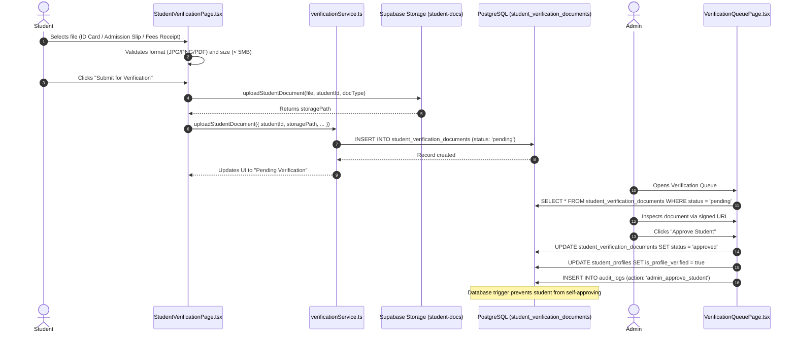
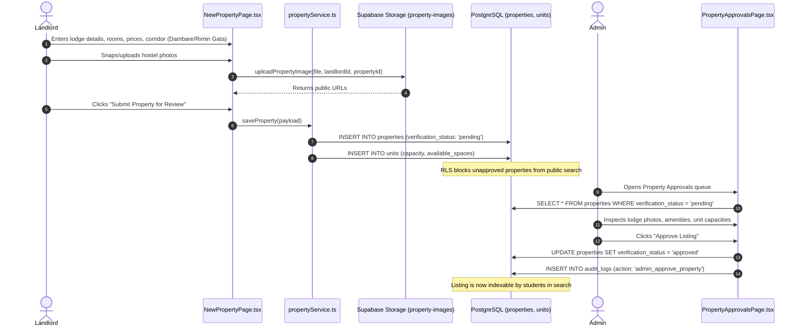
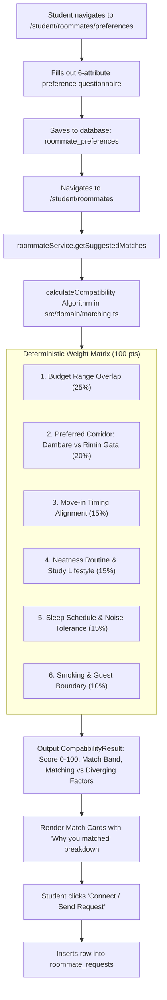
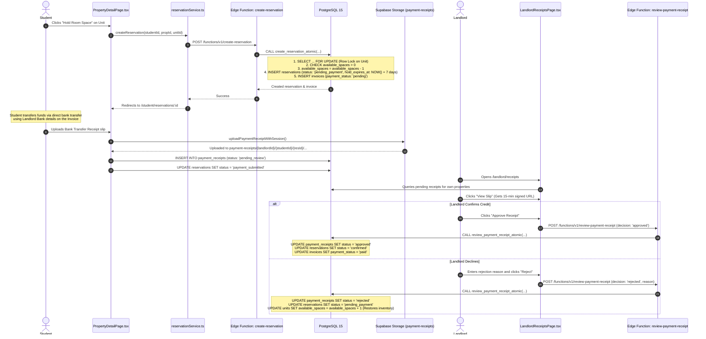
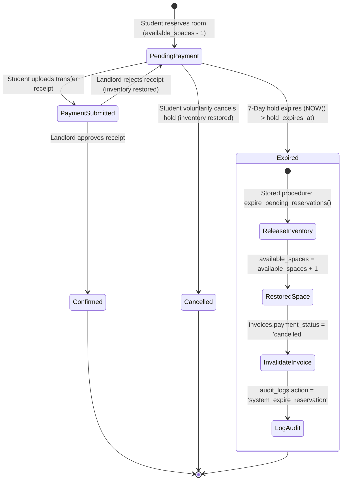
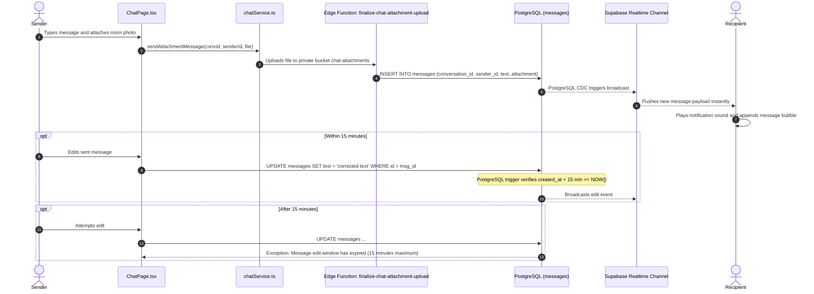

# OUTPOST End-to-End System Workflows

> **Detailed operational workflows, state machines, sequence diagrams, and transaction boundaries across all personas.**

---

## 1. Student Academic Verification Workflow

Ensures only verified Bayero University Kano students access roommate matching and reserve accommodation holds.

---

## 2. Landlord Property Listing & Administrative Approval

Protects students from phantom listings and unverified landlords.

---

## 3. Explainable Roommate Matching & Coordination

Enables verified students to find compatible roommates through transparent arithmetic scoring.

---

## 4. Reservation, 7-Day Hold, External Payment & Receipt Review

The primary transactional workflow managing inventory allocation, invoicing, and bank transfer verification.

---

## 5. 7-Day Hold Expiration Lifecycle

Automated process releasing held unit spaces back into general availability if no payment receipt is submitted within 7 days.

---

## 6. Real-Time Chat & File Attachment Sharing

Peer-to-peer and group messaging with real-time push and strict 15-minute edit boundaries.

